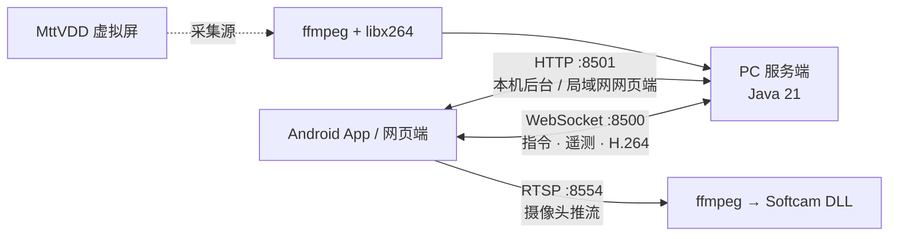

<div align="center">

<h1>Phone Console</h1>

**让吃灰的旧安卓手机，变身 Windows PC 的全能桌面中控台**

<sub>Stream Deck 快捷甲板 · 多指触控板 · 硬件监控屏 · 无线扩展副屏 · 虚拟摄像头</sub>

<p>
<a href="https://github.com/xiaowangWFP/phone-connect-pc/stargazers"></a>
<a href="https://github.com/xiaowangWFP/phone-connect-pc/commits"></a>


</p>

</div>

---

插上一根 USB 数据线，或扫一下局域网二维码 —— 闲置安卓手机立刻成为你电脑旁的桌面效率终端，无需购买昂贵的硬件扩展坞、副屏或外接摄像头。同局域网下的平板、iOS 或电脑浏览器也可直接打开网页控制端使用。

> [!TIP]
> **零环境折腾**：PC 端内置依赖自检脚本，首次启动时自动检测 Java 17+、ffmpeg 与 adb，缺失项可一键下载到项目本地 `deps/` 目录。删除目录即可还原，不污染系统环境变量。

## 为什么用 Phone Console

<table>
<tr>
<td width="50%" valign="top">

<h3>控制甲板 · 像 Stream Deck 一样顺手</h3>

自定义网格快捷键、媒体音量、启动程序、打开网址与执行脚本。监听 Windows 前台窗口进程，切到 <b>IntelliJ IDEA / VS Code</b> 时自动切到「开发模式」面板，切回浏览器自动恢复默认布局。支持长按连发与手机端直接编辑键位。

</td>
<td width="50%" valign="top">

<h3>多手势触控板 + 语音输入</h3>

支持双指滚动、三指切窗口与任务视图、四指切虚拟桌面，以及音量键翻页和可拖拽悬浮快捷键。内置<b>按住说话语音输入</b>，识别结果可直接编辑并发送到 PC 当前光标处。

</td>
</tr>
<tr>
<td width="50%" valign="top">

<h3>实时硬件监视仪表盘</h3>

每秒同步 PC 的 <b>CPU、内存、GPU、显存、上下行网速</b>，以及 Windows Core Audio 真实音量、扬声器与麦克风静音状态。旧手机往支架上一放，就是一块高颜值的桌面监控屏。

</td>
<td width="50%" valign="top">

<h3>低延迟 H.264 副屏（含虚拟显示器）</h3>

PC 端通过 <code>ffmpeg + libx264</code> 低延迟推流，手机端原生硬解码，支持整屏或单显示器裁剪输出。内置 Windows 虚拟显示器驱动（<code>MttVDD</code>），可单独创建一块扩展屏给手机或平板当副屏。

</td>
</tr>
<tr>
<td width="50%" valign="top">

<h3>手机虚拟摄像头</h3>

基于 <code>RootEncoder + RTSP</code> 与 Windows DirectShow 虚拟摄像头（<code>softcam</code>），把手机变成高清电脑摄像头，兼容微信视频、会议软件。支持<b>按需自动唤醒</b>、90° 旋转、镜像翻转、闪光灯与后台保活推流。

</td>
<td width="50%" valign="top">

<h3>USB / 局域网双通道 + 网页控制端</h3>

有线模式通过 <code>adb reverse</code> 自动转发端口，更低延迟且支持插电唤醒应用；无线模式扫码即连。<code>8501</code> 端口自动分流：PC 本机打开管理后台，局域网其他设备打开网页控制端。

</td>
</tr>
</table>

## 快速开始

### 1. 启动 PC 服务端

克隆或下载仓库后，双击根目录的 `工具箱.cmd`（或直接运行 `pc-server\run.cmd`）：

```bat
git clone https://github.com/xiaowangWFP/phone-connect-pc.git
cd phone-connect-pc
工具箱.cmd
```

在工具箱菜单中选择 `[9] 启动服务`，启动完成后会自动打开本机管理后台：<http://127.0.0.1:8501/>。

### 2. 安装手机客户端

发布包中的 `dist/` 目录附带预构建 APK（`phone-console-0.2.0-release.apk`，支持 Android 5.0+）；从源码克隆的话，用工具箱 `[5]` 构建 Release 包即可自动输出到 `dist/`。

| 方式 | 操作 |
| :--- | :--- |
| **ADB 一键安装（推荐）** | 手机开启「USB 调试」并连接电脑，在 `工具箱.cmd` 中选择 `[6]`，直接回车即安装 `dist/` 中最新的 release 包 |
| **手动安装** | 把 `dist/phone-console-0.2.0-release.apk` 复制到手机安装 |

### 3. 连接设备

| 连接方式 | 操作步骤 | 适用场景 |
| :--- | :--- | :--- |
| **USB 有线**（推荐） | 保持数据线连接，服务端每 10 秒自动建立 `adb reverse` 转发，打开 App 直接连接 | 桌面固定摆放、低延迟副屏（默认 30 fps） |
| **局域网 Wi-Fi** | 手机与 PC 处于同一 Wi-Fi，用 App 扫描 PC 管理后台的二维码配对 | 无线远程遥控、躺床当触控板（默认 24 fps） |
| **网页控制端** | 任意同局域网设备浏览器访问 `http://<PC局域网IP>:8501/` | iOS / 平板 / 免安装临时使用 |

> [!NOTE]
> **可选驱动（需管理员权限）**：如需使用「独立虚拟副屏」或「手机虚拟摄像头」，在 `工具箱.cmd` 中一键安装即可。
>
> - **虚拟显示器**：`[2]` 安装驱动 → `[3]` 绑定/刷新驱动（另附 `drivers\vdd\加iPad虚拟屏.cmd`）
> - **虚拟摄像头**：`[12]` 注册虚拟摄像头驱动（卸载用 `[13]`）

## 触控板手势

| 手势 | 映射快捷键 | 功能 |
| :--- | :--- | :--- |
| 双指上下滑动 | 滚轮 | 上下滚动（也可开启音量键滚动） |
| 三指上滑 | <kbd>Win</kbd> + <kbd>Tab</kbd> | 任务视图 |
| 三指下滑 | <kbd>Win</kbd> + <kbd>D</kbd> | 显示 / 返回桌面 |
| 三指右滑 / 左滑 | <kbd>Alt</kbd> + <kbd>Tab</kbd> / <kbd>Alt</kbd> + <kbd>Shift</kbd> + <kbd>Tab</kbd> | 切换下一个 / 上一个窗口 |
| 四指右滑 / 左滑 | <kbd>Ctrl</kbd> + <kbd>Win</kbd> + <kbd>→</kbd> / <kbd>←</kbd> | 切换下一个 / 上一个虚拟桌面 |

## 进阶说明

<details>
<summary><b>系统架构与端口说明</b></summary>

<br />



| 端口 | 协议 | 用途 |
| :--- | :--- | :--- |
| `8500` | WebSocket | 控制指令、硬件遥测与 H.264 屏幕二进制流 |
| `8501` | HTTP | 自动分流：PC 本机访问进入 `admin.html` 管理后台，局域网设备访问进入 `index.html` 网页控制端 |
| `8554` | RTSP | 手机端虚拟摄像头推流端口 |

</details>

<details>
<summary><b>核心配置参考（config.default.json）</b></summary>

<br />

默认配置位于 `pc-server/src/main/resources/config.default.json`，支持通过网页后台或配置文件修改；首次运行后会在 `pc-server/config.json` 生成实际配置。

| 配置项 | 默认值 | 说明 |
| :--- | :--- | :--- |
| `network.wsPort` / `httpPort` | `8500` / `8501` | WebSocket 与 HTTP 服务端口 |
| `network.reversePollMs` | `10000` | ADB 端口转发自动轮询间隔（ms） |
| `screen.monitor` | `-1` | 采集目标：`-1` 为整块桌面，`0` 起为显示器序号 |
| `screen.maxWidth` × `maxHeight` | `1280` × `720` | 屏幕推流分辨率上限（等比缩放无黑边） |
| `screen.usbFps` / `lanFps` | `30` / `24` | USB / 局域网默认推流帧率 |
| `screen.maxBitrateKbps` / `x264Preset` | `3000` / `ultrafast` | H.264 码率上限与编码预设 |
| `camera.rtspPort` / `autoDemand` | `8554` / `true` | 摄像头端口与会议软件按需自动唤醒 |
| `camera.width` × `height` / `fps` / `bitrateKbps` | `1280` × `720` / `30` / `4000` | 虚拟摄像头默认输出画质 |
| `appBindings` | `idea64.exe` / `code.exe` → `ide_page` | 前台进程自动切换控制面板 |

控制甲板支持 5 种动作类型：`hotkey`（组合键）、`media`（媒体与音量）、`launch`（启动程序）、`url`（打开网址）、`script`（执行脚本）。

</details>

<details>
<summary><b>从源码构建</b></summary>

<br />

**PC 服务端**（需 JDK 21 + Maven）：

```bash
cd pc-server
mvn -q -DskipTests package
```

**Android 客户端**（需 JDK 11+ 与 Android SDK `platforms/android-34`，可选配置 `android-client/keystore.properties`）：

```bash
cd android-client
build-apk.cmd
```

也可直接在根目录运行 `工具箱.cmd`，通过菜单 `[4]` `[5]` `[8]` 一键完成构建。

</details>

<details>
<summary><b>项目目录结构</b></summary>

<br />

```text
phone-connect-pc/
├── 工具箱.cmd              # Windows 一体化菜单（环境检查 / 驱动 / 构建 / 安装 / 启动 / 打包）
├── pc-server/              # Java 21 + Maven 服务端（控制、遥测、H.264 推流、Softcam 桥接、Web 后台）
├── android-client/         # Android 客户端（控制甲板、触控板、语音输入、硬解码副屏、RTSP 摄像头）
├── drivers/                # Windows 虚拟显示器 (MttVDD + nefcon) 与虚拟摄像头 (Softcam) 驱动及脚本
├── platform-tools/         # 内置 Windows ADB
├── dist/                   # 预构建 APK 产物
└── bench/                  # 性能基准与热重载测试脚本
```

</details>

<details>
<summary><b>常见问题</b></summary>

<br />

<details>
<summary>插上 USB 后手机无法连接？</summary>

确认手机已开启「USB 调试」并点击「始终允许此计算机调试」，可在 `工具箱.cmd` 运行 `[7]` 查看已连接设备，确认状态为 `device`。

</details>

<details>
<summary>Android 10+ 插线不会自动弹出应用？</summary>

系统限制后台直接拉起 Activity，在手机应用权限中开启「允许后台弹出界面 / 悬浮窗」即可。

</details>

<details>
<summary>提示 8500 / 8501 端口被占用？</summary>

`run.cmd` 会自动结束旧的 Java 进程；若仍冲突，可在配置中修改 `network.wsPort` 与 `network.httpPort`。

</details>

<details>
<summary>局域网连不上或打不开网页控制端？</summary>

确认 PC 与手机在同一局域网，并在 Windows 防火墙放行 `8500`、`8501`（使用虚拟摄像头还需放行 `8554`）。

</details>

</details>

## 技术栈与致谢

| 模块 | 主要依赖 |
| :--- | :--- |
| **PC 服务端** | Java 21 · Java-WebSocket · Gson · OSHI · JNA / Core Audio · ffmpeg |
| **Android 客户端** | AndroidX / Material · OkHttp · Gson · ZXing Core · RootEncoder & RTSP-Server |
| **Windows 驱动** | Softcam（MIT License, tshino）· Virtual Display Driver (MttVDD) · nefcon |

<div align="center">

<br />

如果这个项目帮你盘活了旧手机，欢迎点个 Star 支持

<https://github.com/xiaowangWFP/phone-connect-pc>

</div>
